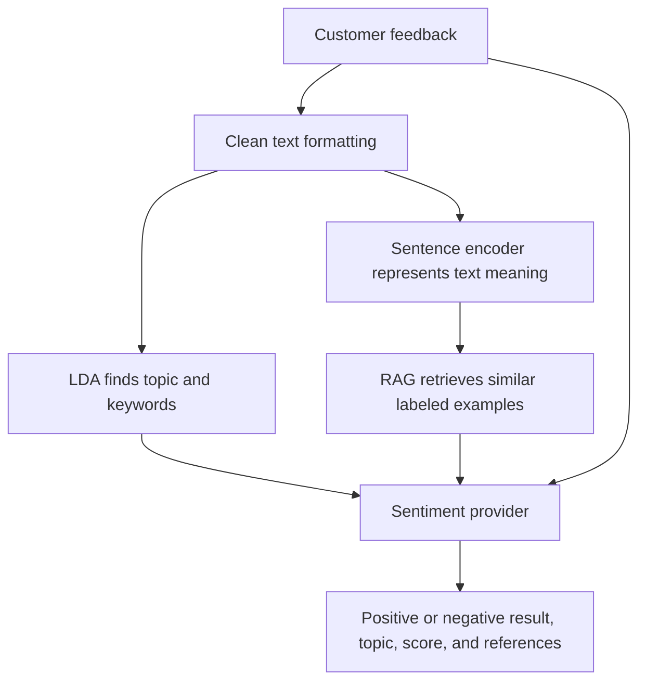

# Current Multivent Sentiment Flow

This project analyzes feedback as **positive or negative**, finds its topic, and shows similar labeled examples that help explain the result.

## 1. Where the datasets came from

We downloaded these published datasets. We did not collect new customer reviews ourselves.

| Dataset and link | Creator / provider | What it contains | Source records examined |
| --- | --- | --- | ---: |
| [HiliSenti v1](https://huggingface.co/datasets/jjjardev/hilisenti-v1) | Jessie James T. Jarder | Hiligaynon sentences, including Tagalog/English code-switching, labeled negative, neutral, or positive. Includes news, social media, translated text, and synthetic examples. | 23,337 |
| [MAMS ACSA](https://huggingface.co/datasets/justinsiow/mams-acsa) | Jiang et al.; mirror by Justin Siow | English restaurant sentences with sentiment labels for aspects such as food, service, staff, price, and ambience. We used the published training-data mirror. | 3,000 |
| [Booking.com Hotel Reviews Dataset](https://huggingface.co/datasets/crawlfeeds/Booking-Hotel-Reviews-Dataset) | Crawl Feeds | Hotel reviews with separate positive and negative text fields. Those fields supply the labels; empty and no-complaint entries are removed. | 4,367 |
| [UCI Sentiment Labelled Sentences](https://archive.ics.uci.edu/dataset/331/sentiment+labelled+sentences) | Dimitrios Kotzias | We used only the Yelp restaurant subset: 500 positive and 500 negative English sentences. | 1,000 |

**Total: 31,704 source records examined.** A hotel review can produce two examples, one from each text field. HiliSenti provides local-language examples; the other datasets provide restaurant, service, and hospitality examples.

## 2. What was done to the data

1. Saved the original downloads and their source information.
2. Cleaned spacing and text formatting without translating the sentences.
3. Kept positive and negative examples. Removed neutral entries, conflicting sentiment labels, empty entries, and duplicates.
4. Separated training, validation, and testing data.
5. Selected training examples relevant to services, food, venues, and hospitality.
6. Fitted the topic model and built the searchable reference collection.

## 3. Training and testing percentages

The additional restaurant/hotel datasets use an **approximately 80% training / 10% validation / 10% testing** assignment. HiliSenti keeps its original splits. Parts of the same hotel review stay together.

After cleaning and deduplication, before relevance filtering and balancing, the actual combined split is:

| Split | Examples | Percentage | Purpose |
| --- | ---: | ---: | --- |
| Training | 18,411 | 79.46% | Supply topic-training text and sentiment references |
| Validation | 2,376 | 10.25% | Set aside for development and tuning |
| Testing | 2,384 | 10.29% | Set aside to measure performance on unseen examples |
| **Total** | **23,171** | **100%** | |

The final training resources are smaller because of relevance filtering:

- **LDA topic model:** fitted on 4,462 relevant training examples to discover 10 topics.
- **RAG reference collection:** 3,050 training examples, balanced as 1,525 positive and 1,525 negative.
- **Test set:** 1,594 HiliSenti examples + 790 restaurant/hotel examples. Test examples are not filtered by relevance or balanced.

Validation and test examples are excluded from topic training and the current reference collection. The sentence encoder is pretrained; we did not fine-tune a new sentiment classifier.

## 4. Simple pipeline

Preparation:

```text
Download the four datasets
  -> Clean text and keep valid positive/negative examples
  -> Separate splits and remove duplicates across them
  -> Select relevant training examples
  -> Fit LDA topics + build the RAG reference collection
```

When someone submits feedback:



**LDA** finds topics. **RAG** retrieves examples rather than generating the verdict itself. By default, retrieval aims for two HiliSenti examples and four restaurant/hotel examples.

The sentiment provider can use the implemented OpenAI adapter when configured, or a local fallback that votes using the references' similarity, relevance, and source weights. The fallback score is an evidence share, not a guaranteed probability of correctness.

## 5. Current progress

- Dataset preparation, topic training, and reference-index building have saved outputs locally.
- A local API and browser page are implemented for trying feedback.
- All **54 automated tests passed** during the GitHub upload check.
- The saved older accuracy report belongs to the earlier three-class experiment; it does not establish accuracy for this current binary pipeline.

This summary follows the current code, [dataset registry](multivent-sentiment/config/datasets.yaml), and locally saved corpus reports. Dataset files and generated models are excluded from GitHub by the existing ignore rules.
