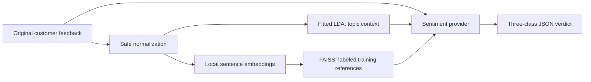

# Multivent Sentiment Lab

An isolated Python experiment for a BSIT capstone. It prepares HiliSenti v1, discovers
topics, retrieves labeled examples, and exposes replaceable sentiment providers through
a local FastAPI API and browser page. No Multivent frontend/backend integration is made.



LDA uses text counts for **topic discovery only**. Retrieval uses a frozen pretrained
encoder and cosine similarity. The sentiment provider produces the final three-class
response. There is no transformer classifier training or fine-tuning. Local mode uses
no paid API, remote database, Docker, or OpenAI embeddings. The initial dependency,
dataset, and embedding downloads require internet; inference runs locally afterward.

## Windows + VS Code setup

Install 64-bit Python 3.11 or newer and VS Code's Python extension. This workspace was
tested with Python 3.13.5 on Windows. Allow several GB of disk space for PyTorch, the
virtual environment, and model/download caches. CPU is the default; no GPU is required.

From the parent workspace in PowerShell:

```powershell
cd "D:\Sentiment Training\multivent-sentiment"
python -m venv .venv
.\.venv\Scripts\Activate.ps1
python -m pip install -r requirements.txt
Copy-Item .env.example .env
python scripts/download_hilisenti.py
python scripts/clean_dataset.py
python scripts/train_lda.py
python scripts/build_rag_index.py
python scripts/inspect_topics.py
python -m pytest
uvicorn app.main:app --host 127.0.0.1 --port 8000 --reload
```

Use your actual checkout path on another machine. If `.env` already exists, preserve
it rather than copying over it. In VS Code run **Python: Select Interpreter** and select
`.venv\Scripts\python.exe`. If PowerShell blocks activation, activation is optional:

```powershell
.\.venv\Scripts\python.exe -m pip install -r requirements.txt
.\.venv\Scripts\python.exe scripts/download_hilisenti.py
.\.venv\Scripts\python.exe -m uvicorn app.main:app --reload
```

Use the same explicit interpreter prefix for the remaining scripts. No execution-policy
change or administrator terminal is normally needed. Model/index building can take several
minutes on a CPU. Stop the server before rebuilding artifacts, then restart it afterward.

`requirements-lock.txt` records the exact versions used in the verified Python 3.13
environment. Use `pip install -r requirements-lock.txt` instead for that reproducible
environment; `requirements.txt` allows compatible versions on other Python releases.

An optional real-browser smoke test uses an installed Chrome (or `--browser msedge`):

```powershell
python -m pip install -r requirements-dev.txt
# With the local server already running and AI_PROVIDER=rag_fallback:
python scripts/smoke_browser.py
```

It submits real feedback, checks rendered references and mobile layout, and saves
`reports/ui-desktop.png` and `reports/ui-mobile.png`. Ordinary pytest tests use tiny
explicit test encoders, never downloaded weights or paid APIs. The evaluation script
and browser smoke test use the actual locally saved NLP artifacts.

Open **http://127.0.0.1:8000** for the testing page and
**http://127.0.0.1:8000/docs** for interactive API documentation.
`/ui` is an explicit UI URL. `/` serves HTML for browser `Accept: text/html` requests
and application status JSON for REST clients. The UI shows the verdict, vote share or
estimated confidence, language, topic, keywords, provider, reason, and references.

## API

| Method | Path | Purpose |
|---|---|---|
| GET | `/` | Status JSON, or testing UI for a browser |
| GET | `/health` | Actual loaded components, selected provider, key presence |
| POST | `/analyze` | Full pipeline |
| POST | `/normalize` | Audit informal Hiligaynon/Filipino normalization |
| POST | `/retrieve` | References; optional `top_k` from 1 to 100 |
| POST | `/topic` | Dominant LDA topic |
| GET | `/topics` | All topic terms and editable human names |
| GET | `/dataset/stats` | Cleaning and dataset statistics |

PowerShell request:

```powershell
$body = @{ feedback = "Tuman kadugay gid ya sang caterer pero nami ang food." } | ConvertTo-Json
Invoke-RestMethod -Uri "http://127.0.0.1:8000/analyze" -Method Post -ContentType "application/json; charset=utf-8" -Body ([System.Text.Encoding]::UTF8.GetBytes($body)) | ConvertTo-Json -Depth 10
```

Equivalent JSON input:

```json
{"feedback": "Nami gid sang service nila."}
```

Responses have `feedback`, `sentiment`, `confidence`, `language`, `provider`, `reason`,
`topic` (`id`, `name`, `probability`, `keywords`, `in_vocabulary`), and
`rag.retrieved_examples` (`id`, `sentence`, `label`, `sentiment`, `similarity_score`,
`split`, `source`). Cosine similarity is in [-1, 1], not a probability.
The server validates nonblank text with letters/numbers and at most 5,000 characters.
Invalid input returns 422; missing models/data return actionable 503 errors.
Provider failures return 502. Health remains available with `status: degraded`
when components are unavailable. `openai_configured` means a nonblank key exists;
it does not claim the key was authenticated.

## Informal feedback normalization

Inference applies conservative, token-boundary-aware normalization before LDA topic
inference and embedding/RAG retrieval. The response preserves `text_original`, exposes
`text_normalized`, and lists each auditable normalization with its source. The original
feedback remains the provider input unless optional PII sanitization is enabled.

Mappings live in `app/preprocessing/dictionaries/`. FiliSenti's Apache-2.0 normalization
implementation is the reference for selected Filipino/Hiligaynon mappings and safe
structural rules. Filipino Slang Norm is reference-only because its declared license is
unknown; none of its records are redistributed. See
[`reports/normalization_sources.md`](reports/normalization_sources.md) for provenance,
loaded mappings, exclusions, and the licensing review.

Example:

```powershell
$body = @{ text = "Nmi gd ila service pero dugay lg" } | ConvertTo-Json
Invoke-RestMethod -Uri "http://127.0.0.1:8000/normalize" -Method Post -ContentType "application/json" -Body $body
```

## Artifacts and module layout

| Path | Contents |
|---|---|
| `data/raw/hilisenti/source/` | Unmodified `train.csv`, `val.csv`, `test.csv` |
| `data/raw/hilisenti/manifest.json` | Resolved source revision and file checksums |
| `data/processed/hilisenti_clean.csv` | Clean data with original text and split provenance |
| `data/processed/rejected_rows.csv` | Malformed rows and reasons |
| `data/processed/duplicate_rows.csv` | Removed duplicates and reasons |
| `data/processed/dataset_report.json` | Counts, missing cells, normalization, revision |
| `data/stopwords/` | Conservative editable LDA stopword files |
| `models/lda/lda_model.joblib` | Fitted sklearn LDA |
| `models/lda/vectorizer.joblib` | Fitted training vocabulary |
| `models/lda/topics.json` | Keywords, settings, train fingerprints, checksums |
| `models/embeddings/encoder/` | Saved local sentence encoder and identity |
| `vector_store/index.faiss` | Normalized-vector FAISS IndexFlatIP |
| `vector_store/metadata.json` | Labeled retrieval records |
| `vector_store/manifest.json` | Encoder identity, held-out hashes, provenance/checksums |
| `reports/` | Evaluation JSON, confusion matrix, per-row predictions |
| `logs/analysis.jsonl` | Optional timestamped local experiment events |

`app/preprocessing`, `app/topics`, `app/rag`, and `app/sentiment` own distinct NLP
responsibilities. `app/services` orchestrates them; `app/schemas` defines contracts;
`app/api` exposes routes. `scripts` contains reproducible preparation/evaluation commands.
Use only locally generated trusted joblib/FAISS files. The checksum manifests detect
accidental mismatches; they are not signatures for untrusted artifacts.

## Dataset preparation and leakage controls

The downloader tries normal Hugging Face loading first, then falls back to preserved
Hub CSV files. The cleaner handles nested surrounding quotes/whitespace around valid
numeric labels. See [data/README.md](data/README.md) for normalization, attribution,
quarantine, duplicate, and PII policies.

- LDA trains on **train only**, using `sentence_clean`, never sentiment labels.
- RAG defaults to **train only**. `RAG_INCLUDE_VALIDATION=true` adds validation.
- RAG construction and loading reject `split=test` and unknown split metadata.
- Case-insensitive exact text duplicates are reserved in test, then validation,
  then train; matching training copies are removed and audited.
- Evaluation separately checks test fingerprints against RAG text and LDA training
  fingerprints, and checks that the processed dataset matches the index build.

Exact-text checks do not detect paraphrases or related news events. Manual near-duplicate
and domain review remain useful before claiming final capstone results. A cleaned test
set with duplicates removed is not identical to the source author's test benchmark.

## Topics and embeddings

Defaults: 10 LDA topics, up to 10,000 features, `min_df=2`, `max_df=0.95`, 20 batch
iterations, and seed 42. `LDA_NGRAM_MAX=2` enables bigrams. The stopword files start
empty; consult a native speaker before editing. Only LDA count features lowercase and
tokenize word characters; original/clean provider and embedding text retain punctuation.

Run `python scripts/inspect_topics.py`, then edit `app/topics/topic_names.py` to assign
names after inspecting terms. Names default to `Unassigned Topic N`; retraining can change
topic IDs. An input with no known vocabulary returns `id=null`, zero probability,
and `No known topic terms` instead of inventing a topic.

The default encoder is `sentence-transformers/paraphrase-multilingual-MiniLM-L12-v2`.
It is a compact multilingual baseline, not a validated Hiligaynon encoder. The
[Sentence Transformers language documentation](https://www.sbert.net/docs/sentence_transformer/pretrained_models.html#multilingual-models)
does not list Hiligaynon or Tagalog among this model's training languages; its underlying
multilingual vocabulary can encode those texts, but useful retrieval must be measured
and inspected. English/code-switching coverage does not establish Hiligaynon quality.
No transformer is trained here. Long texts are token-window chunked and their normalized
embeddings mean pooled before FAISS search, avoiding silent whole-feedback truncation.

The encoder is behind `EmbeddingProvider`. Future embedding adapters implement `identity`
and `encode`. The saved identity includes requested and resolved model revision, dimension,
and pooling strategy. Query and index encoders must match. Changing the embedding model
requires archiving `models/embeddings/encoder/`, downloading the new encoder, and rebuilding
the index. `EMBEDDING_LOCAL_FILES_ONLY=true` forbids model downloads; after initial setup
the saved encoder loads locally regardless. No OpenAI embedding endpoint is called.

## Sentiment providers and future OpenAI activation

`AI_PROVIDER=rag_fallback` is the default. It sums `max(0, cosine_similarity)` per
sentiment label, chooses the largest total, and divides that total by all votes for
`confidence`. Ties or no usable similarity evidence return neutral with zero confidence.
The response identifies `provider=rag_weighted_fallback`. This is a provisional retrieval
baseline, not the intended final AI verdict. Even 100% vote agreement is not a calibrated
probability of correctness. Language is honestly `unknown`; no language detector is present.

`AI_PROVIDER=mock` always returns a clearly simulated neutral response with zero
confidence. All providers use the same `SentimentProvider.analyze` contract and exactly
three output classes. Mixed-class output is not exposed.

To use OpenAI later, edit the local, ignored `.env`:

```dotenv
AI_PROVIDER=openai
OPENAI_API_KEY=your-own-key
OPENAI_MODEL=your-chosen-responses-compatible-model
```

Choose a model your account can access that supports Responses structured outputs,
then restart Uvicorn. The adapter is implemented using `client.responses.parse`, a
Pydantic schema, and `store=False`, following the
[official structured outputs guide](https://developers.openai.com/api/docs/guides/structured-outputs).
No other source change is needed. A blank key automatically selects the local fallback
for application requests. A present key with a missing model produces a configuration
error. Invalid keys, refusals, timeouts, or quota errors produce explicit provider errors;
they are not disguised as successful OpenAI output.

The provider receives original-language feedback, discovered topic terms, and labeled
references. It treats those texts as data, asks for direct original-language interpretation,
and returns structured sentiment, estimated confidence, language, and reason. The unified
response retains the actual LDA topic rather than letting the AI rename it. Activating
OpenAI sends feedback and retrieved examples to that external service; review PII first.
API keys are never serialized into experiment logs or responses.

For a deployed API, set `ANALYSIS_API_KEY` to a long random value and send the same value
in the `X-Analysis-Key` request header. When configured, `/analyze`, `/normalize`,
`/retrieve`, `/topic`, `/topics`, and `/dataset/stats` reject missing or invalid keys;
`/health` remains public for service monitoring. The local browser test page is intended
for development and does not attach this production header.

## Evaluation

```powershell
python scripts/evaluate.py --limit 100
python scripts/evaluate.py
# Later, after configuring a key and model:
python scripts/evaluate.py --provider openai --limit 100
```

The default runs the configured provider on every clean **test** row. `--limit` selects
a reproducible random subset with the configured seed. All rows run the complete
normalization → LDA → embedding/RAG → provider pipeline. Evaluation does not fit any
component. OpenAI evaluation fails early without both key and model, so it cannot
accidentally publish fallback metrics as OpenAI metrics. OpenAI evaluation incurs API
charges; use a limit for initial paid experiments.

Outputs are `reports/evaluation.json` (accuracy, macro precision/recall/F1, matrix,
provider, encoder identity, artifact checksums, seed, subset size, elapsed time),
`reports/confusion_matrix.csv` (rows=actual, columns=predicted; negative/neutral/positive),
and `reports/predictions.csv`. Each run replaces those report files; archive reports
before changing the provider/configuration. Logs append ground truth and per-request
latency if enabled. Do development/model selection on validation data in a separate
experiment with validation excluded from RAG; reserve test runs for final measurement.

## Logging, privacy, and troubleshooting

`ENABLE_ANALYSIS_LOGGING=true` writes one local JSONL record per analysis, with UTC
timestamp, feedback, topic, reference IDs, actual provider, verdict, confidence,
ground truth when supplied by evaluation, and elapsed milliseconds. Set it false to
disable. These files may contain PII. The single-process logger uses a write lock;
use the default one-worker server for this experiment.

`ENABLE_PII_SANITIZATION=false` preserves experimental text. If enabled, conservative
email/PH-mobile masking applies to normalized inference text and logs. It does not
anonymize names/locations, erase raw originals, or remove original feedback from the
API response. PII must be reviewed before redistributing derived data. See data notes.

- **Missing artifacts / 503:** run preparation scripts in order and restart Uvicorn.
- **Quoted-label upstream failure:** expected; the Hub CSV fallback handles it.
- **Network error:** first downloads need Hugging Face/PyPI access. Retry the script;
  completed raw snapshots are verified rather than overwritten.
- **Windows symlink warning:** cached file copies still work; `.env.example` suppresses
  the optional warning. Developer Mode is not required.
- **FAISS install failure:** verify a supported 64-bit CPython and update pip; do not
  replace the vector index with fabricated retrieval output.
- **Empty LDA vocabulary:** inspect data or lower `LDA_MIN_DF` for a tiny fixture.
- **PII/model configuration mismatch:** re-clean/retrain/rebuild affected artifacts.
- **No language estimate:** local fallback deliberately reports unknown.
- **Topic or sentiment seems wrong:** inspect references and terms; news/product-review
  coverage and a multilingual baseline do not establish event-service accuracy.

## Research attribution

HiliSenti v1 is by Jessie James T. Jarder, licensed CC BY-NC-SA 4.0, used here for
non-commercial academic research. [Dataset card](https://huggingface.co/datasets/jjjardev/hilisenti-v1),
[permanent DOI](https://doi.org/10.57967/hf/8737), and [local data notes](data/README.md).
The source card describes a mixture of collected, translated, and synthetic material.
This project does not claim to have created the original labels or reproduce the
author's separately trained classifier results. No accuracy is claimed without an
actual report from this pipeline.

See [VALIDATION.md](VALIDATION.md) for the completed checks, actual fallback test-set
metrics, dataset counts, and observed limitations from this workspace.
